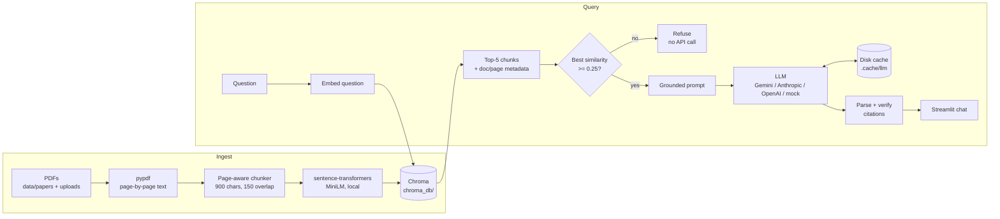

# research-paper-rag

A retrieval-augmented generation (RAG) assistant that answers questions about a folder of engineering research PDFs. Every answer **cites the document and page** it came from. If the answer isn't in the sources, it **refuses**.

## Problem

Engineers keep dozens of papers on hand and need precise answers: which hyperparameters, what error rate, what architectural trick. A general-purpose chatbot answers from memory, can hallucinate numbers, and can't tell you where a claim came from. This tool answers **only** from your PDFs, and every claim can be checked against a page reference.

## Approach

1. **Load:** `pypdf` extracts text page by page.
2. **Chunk:** text is split into ~900-character overlapping chunks that **never cross a page boundary**, so each chunk's page number is exact.
3. **Embed:** chunks are embedded locally with `sentence-transformers/all-MiniLM-L6-v2` (no API calls).
4. **Store:** vectors go into a persistent **Chroma** collection (cosine similarity).
5. **Retrieve:** the top 5 chunks are returned for each question.
6. **Generate:** the LLM (Gemini Flash-Lite by default) gets the numbered passages and strict rules: cite `[doc.pdf, p. N]` after every claim, or reply with a fixed refusal sentence.
7. **Verify:** citations are parsed from the answer and checked against the passages that were actually retrieved.

The system refuses in two places:
- **Retrieval gate:** if the best similarity is below 0.25, it refuses without calling the LLM, which also saves cost.
- **Prompt rule:** the model must return an exact refusal string when the context doesn't contain the answer.

## Architecture



## Results

The evaluation runs on 5 open-access arXiv papers (Transformer, Adam, Batch Normalization, WaveNet, ResNet) with **15 hand-written questions**: 12 that the papers answer, and 3 that they don't (out-of-domain or about other papers). Each question's expected facts and page numbers were taken from the extracted PDF text. Scoring is deterministic string and page matching, with no LLM judge.

| Metric | Gemini `gemini-3.5-flash-lite` | `--mock` (retrieval-only baseline) |
|---|---|---|
| Answer accuracy (12 answerable) | **83.3%** (10/12) | 0% |
| Citation correctness: cited doc + page (±1) matches the expected page | **83.3%** (10/12) | 75.0% |
| Citation grounding: cited pages that were actually retrieved | **92.3%** (12/13) | 100% |
| Refusal accuracy (3 unanswerable) | **100%** (3/3) | 33.3% |
| False refusals | 1 | 0 |
| **Overall (15)** | **86.7%** | 6.7% |

The full eval used 14 LLM calls. One question was refused at the retrieval gate, and reruns are served from the cache.

**Failure analysis:**
- **q05 (Adam default hyperparameters):** a retrieval miss. The defaults sit inside Algorithm 1 on page 2, which is dense with math, and that chunk didn't rank in the top 5. The model correctly refused rather than guess. This is the one false refusal.
- **q07 ("what does BatchNorm reduce?"):** retrieval returned pages 3, 5, 6, and 8 instead of the abstract and introduction (pages 1–2), so the answer described the benefits but never named *internal covariate shift*.
- **Grounding 12/13:** for one answer the model cited `p. 2, 3`, and page 3 wasn't among the retrieved passages.
- **Mock baseline:** the mock "LLM" just quotes the top passage. It shows that retrieval alone already finds the right page for 75% of the questions. The LLM adds synthesis and proper refusals.

During development, the first real run scored 75%. Two failures turned out to be bugs in my tooling, not in the model: the citation parser didn't handle multi-page citations like `p. 2, 3`, and the scorer didn't normalize LaTeX `$\mu$`. I fixed both and rescored the cached responses at no extra API cost.

## How to run

Requires Python 3.12.

```bash
git clone https://github.com/arbablatif/research-paper-rag.git
cd research-paper-rag
python -m venv .venv && .venv\Scripts\activate      # Windows (source .venv/bin/activate on macOS/Linux)
pip install -r requirements.txt

cp .env.example .env        # then add your GEMINI_API_KEY
python scripts/download_papers.py   # 5 sample arXiv papers -> data/papers/
python ingest.py                    # build the Chroma index

streamlit run app.py                # chat UI (upload more PDFs in the sidebar)
streamlit run app.py -- --mock      # same UI, zero API calls
```

To evaluate and test:

```bash
python eval/run_eval.py --mock      # end to end, no API calls
python eval/run_eval.py             # real LLM (~15 calls, cached afterwards)
pytest -q                           # unit tests + mock pipeline test
```

To switch providers, set `LLM_PROVIDER=anthropic` or `openai` in `.env`, together with that provider's key. You can override model names with `GEMINI_MODEL`, `ANTHROPIC_MODEL`, and `OPENAI_MODEL`.

## Project structure

```
src/rag/
  config.py      settings (paths, chunking, retrieval, provider)
  loader.py      PDF -> page records
  chunker.py     page-aware chunking
  embedder.py    local sentence-transformers
  store.py       Chroma wrapper
  prompts.py     grounded prompt + refusal string
  llm.py         Gemini / Anthropic / OpenAI / mock + disk cache
  pipeline.py    ingest(), RAG.answer(), citation parsing/verification
app.py           Streamlit chat UI
ingest.py        CLI indexer
eval/            qa.json (15 items), run_eval.py, results*.json
tests/           pytest suite
```

## Limitations

- **Text-only extraction.** Equations, tables, and figures come through as flattened text. Content inside algorithm boxes, like the Adam defaults, retrieves poorly.
- **Pure dense retrieval.** Adding BM25 hybrid search or a cross-encoder reranker would likely fix both retrieval misses above.
- **No OCR.** Scanned PDFs without a text layer can't be indexed.
- **Small eval.** 15 questions is a smoke test, not a benchmark. String-match scoring can miss correct paraphrases.
- **Fixed similarity gate.** The 0.25 threshold was tuned by eye for MiniLM, and a different embedding model would need it re-tuned.
- **Single-turn.** Follow-up questions don't use chat history for retrieval.
